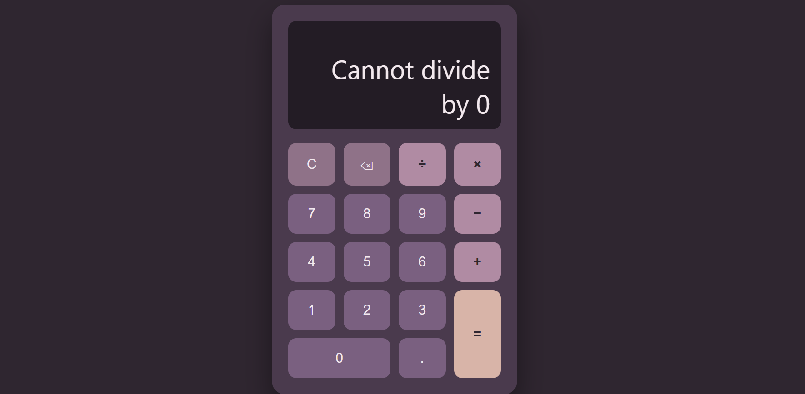

# Task 1: Calculator

A browser-based calculator built with HTML, CSS and vanilla JavaScript.

## Screenshot

## Features
- Number buttons (0-9) and decimal point
- Addition, subtraction, multiplication and division
- Equals, Clear (C) and Backspace (removes digits and operators)
- Division by zero shows an error message instead of crashing
- Operator chaining without a reset
- Button layout built with CSS Grid
- No `eval()`: all logic is written with variables and conditionals

## How it works
- One click listener on the button container reads `data-` attributes to decide the action.
- `calculate()` uses a `switch` statement to apply the operator.
- Operations are evaluated left to right as they are entered, like a basic pocket calculator (5 + 3 × 2 = 16).

## Live demo
https://aimansanaullah5-ops.github.io/OIBSIP/level-2/task-1-calculator/

## What I learned
(Write 2-3 sentences in your own words: what was hard, which bugs you fixed, what you would improve.)

## Resources
- MDN: addEventListener, switch, parseFloat
- (Name the YouTube tutorial you watched)