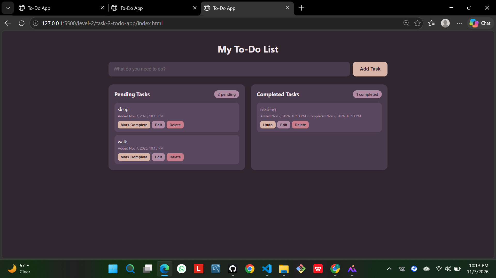

# Task 3: To-Do Web App

An interactive to-do list built with HTML, CSS and vanilla JavaScript. Tasks are organised into Pending and Completed lists.

## Screenshot

## Features
- Add new tasks with the input field and the Add Task button
- New tasks appear immediately in the Pending list
- Mark Complete button moves a task to the Completed list, and Undo moves it back
- Inline editing: Edit turns the text into an input, Enter or Save keeps the change, Escape cancels
- Delete button removes a task from either list
- Counters above each list ("X pending" and "Y completed")
- Friendly empty-state messages when a list has no tasks
- Timestamps showing when each task was added and completed (bonus)
- Tasks are saved with localStorage, so they stay after a page refresh (bonus)
- Responsive layout built with CSS Grid

## How it works
- All tasks live in one array of objects, and `render()` redraws both lists from it every time something changes.
- One click listener per list handles every button, even for tasks created later (event delegation).
- User text is inserted with `textContent`, never `innerHTML`, so typed text cannot inject HTML.
- The array is saved to localStorage after each change and loaded again on startup.

## What I learned
<2-3 sentences in your own words>

## Resources
- MDN: DOM manipulation, localStorage, event delegation
- I used an AI assistant to help me with the structure and logic, and I tested and debugged the app myself.