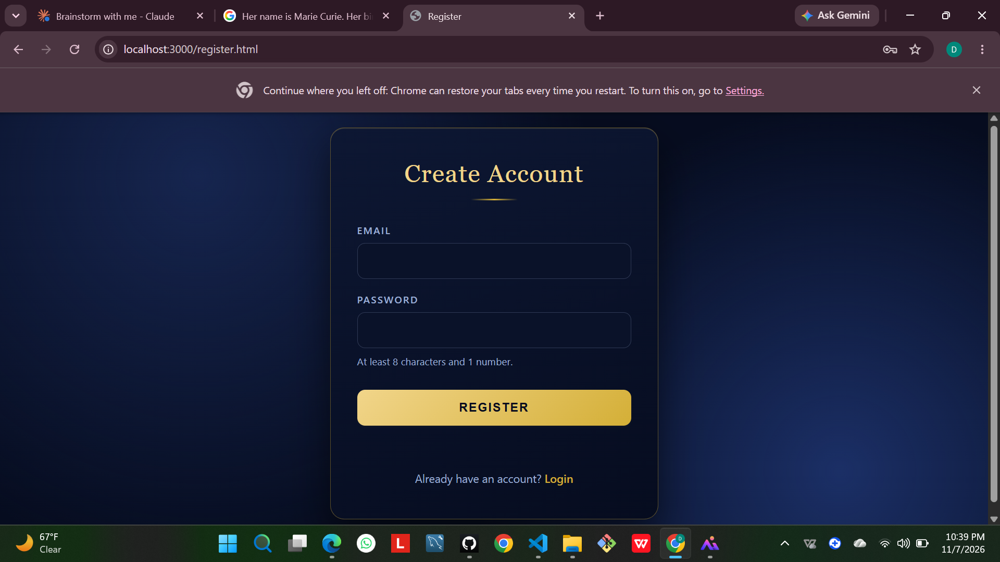
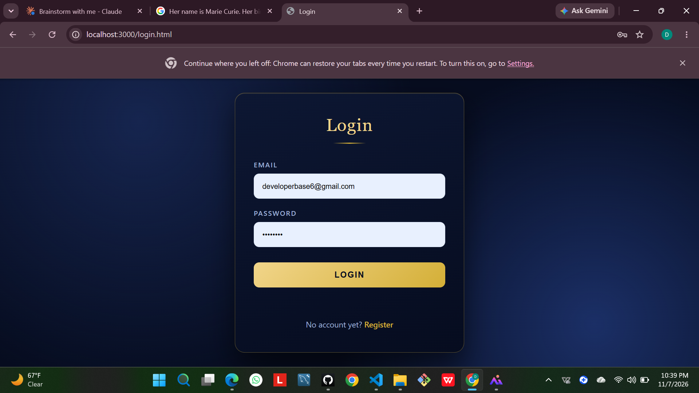

# Task 4: Login Authentication System

A full-stack authentication system built with Node.js, Express and bcrypt. Users can register, log in, see a protected dashboard and log out.

## Screenshots

## Features
- Registration with email and password
- Password rules: minimum 8 characters and at least 1 number, checked in the browser and again on the server
- Duplicate email check with a clear error message
- Login with one generic message ("Invalid email or password"), so it never reveals which field was wrong
- Protected dashboard: opening `/dashboard` without a session redirects to the login page
- Logout button that destroys the session and redirects to the login page
- Passwords are hashed with bcrypt (bcryptjs) and never stored in plain text
- Form validation on both pages (no empty submissions)

## Tech stack
Approach B (full-stack): Node.js, Express, express-session, bcryptjs, a JSON file as a simple user store, and plain HTML, CSS and JavaScript on the front end.

## How to run
1. Install dependencies: `npm install`
2. Start the server: `npm start`
3. Open `http://localhost:3000` in your browser

## How it works
- `server.js` exposes `/api/register`, `/api/login`, `/api/logout` and `/api/me`.
- On login the server stores the user's email in a session, which the browser keeps in a cookie.
- `dashboard.html` lives in the `views` folder (not `public`), so it can only be reached through the `/dashboard` route, which checks the session first.
- Users are saved in `data/users.json`, which is excluded from Git.

## Limitations
- A JSON file is fine for a demo but not for production, where a real database would be used.
- In production the `SESSION_SECRET` environment variable must be set to a long random value.

## Resources
- MDN: HTTP cookies and sessions
- Express and bcrypt documentation
- I used an AI assistant to help me with the structure and logic, and I tested and debugged the app myself.